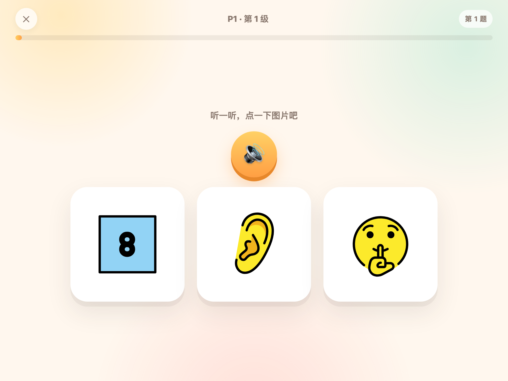
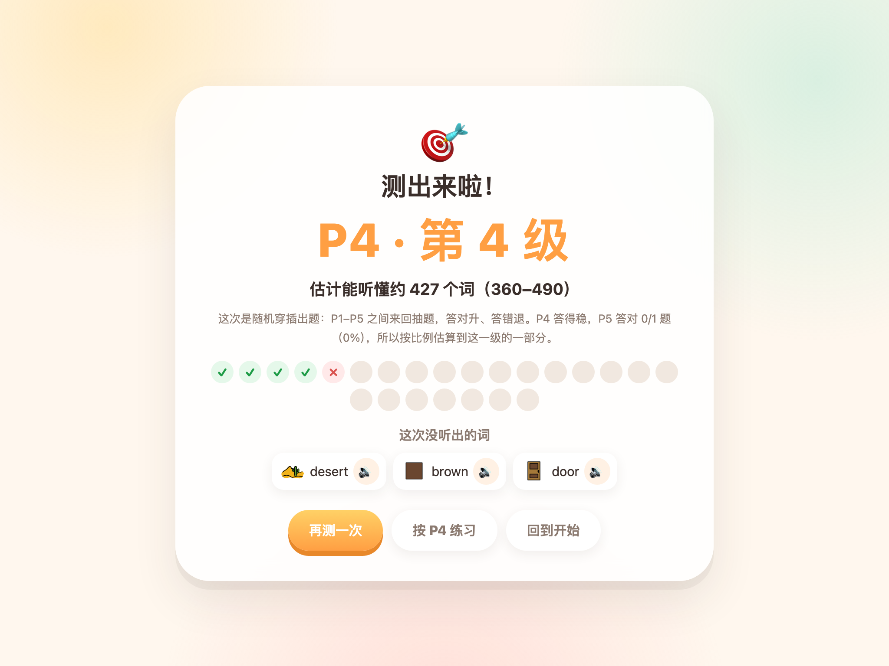
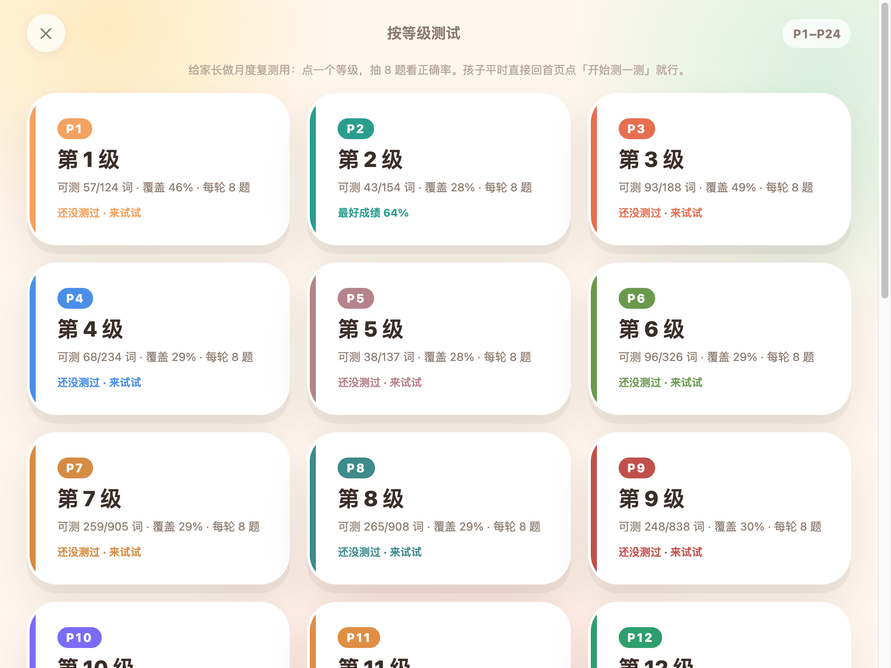
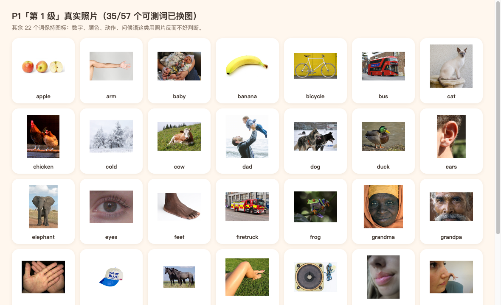
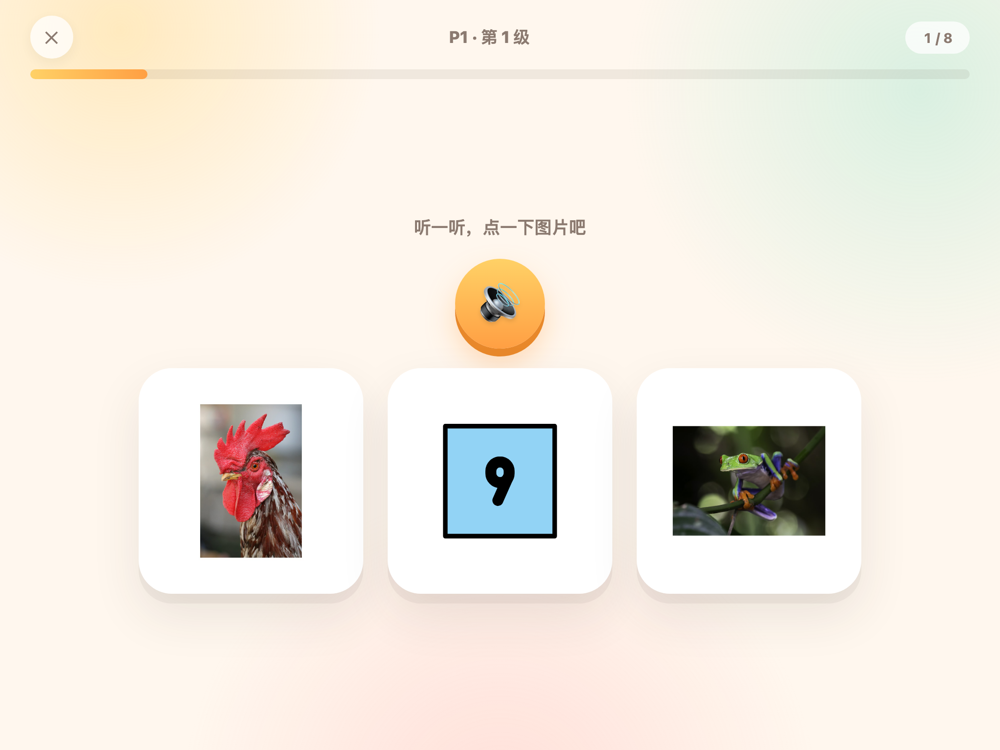

# 单词小侦探 · 儿童词汇量小测（网页版）

> **由 DeepSeek 制作 / Made by DeepSeek** · 面向 3 岁宝宝的「听音选图」词汇量小测，纯静态网页，iPad / 手机 / 电脑都能用。

用「听声音 → 选图片」的方式，测小朋友在某个等级里能认出多少词。
纯静态网页：一个文件夹，双击就能跑，iPad / 手机 / 电脑都能用，不需要安装任何软件。

当前数据：**小小优趣完整单词表 24 个等级（P1–P24）**，去重后 3694 个词，其中 515 个可测词、共 4010 个可测条目（同一个词可能在多个等级出现）、515 段单词音频。P1 的 57 个可测词里已有 **35 个换成真实照片**，其余仍用 OpenMoji 图标兜底；后续等级会陆续补照片。

---

## 一、结论：现阶段做网页，不做苹果 App

| 维度 | 网页（本方案） | 原生 iOS App |
| --- | --- | --- |
| 开发门槛 | 会写 HTML/CSS/JS 即可，马上能改 | 需要 Xcode、Swift、开发者账号（$99/年） |
| 分发 | 发个链接/文件夹就能用，改完刷新即生效 | 要过 App Store 审核，或用 TestFlight 内测 |
| 设备 | iPad / iPhone / 安卓 / 电脑全支持 | 只能苹果，且要单独适配 |
| 儿童误触 | Safari 全屏 + 引导式访问即可锁住 | 需要自己处理 |
| 数据 | 直接读本地 words.json，改词表 0 成本 | 数据要打包进 App，改词要重新发版 |
| 成本 | 0 | 开发者账号 + 审核时间 |
| 未来升级 | 需要上架时，用 Capacitor 把同一套网页壳成 App，几乎不用重写 | — |

孩子才 3 岁，测试场景是「家长拿着 iPad 坐在旁边陪着点」，网页 + Safari「添加到主屏幕」完全够用。
唯一要注意的是：**一定要用「引导式访问」把页面锁住**，否则小朋友会切到别的 App。

> 等词表、图片、流程都打磨满意了，再考虑花半天用 Capacitor 包成 App 上架也不迟。

## 界面预览

| 首页（自适应测级） | 测试（听音选图 + 点击音） | 结果（等级 + 词汇量估计） |
| --- | --- | --- |
|  |  |  |

| 家长设置 | 按等级测试（月度复测） | 手机竖屏 |
| --- | --- | --- |
|  |  |  |

| P1 真实照片卡片（新增） | P1 测试页：照片 + 图标混排 |
| --- | --- |
|  |  |

---

## 二、快速开始

### 电脑上试玩（macOS）

- 双击 `start.command`（会自动起本地服务并打开浏览器）；
- 或者打开终端，进入本文件夹后运行：

```bash
cd vocab-test
python3 -m http.server 8765
```

然后浏览器打开 <http://localhost:8765>。

> 不能直接双击 `index.html`：浏览器对本地文件的 `fetch` 有限制，词表会读不出来。

### 局域网访问（iPad / 手机直接打开）

电脑和 iPad 连同一个 Wi-Fi，然后在 iPad 的 Safari 里打开电脑的局域网地址（不是 localhost）：

- 优先用 Bonjour 名字：`http://Kyle-Mac-Mini.local:8765`
- 或者当前 IP（换网络会变）：`http://192.168.0.126:8765`（Wi-Fi）、`http://192.168.0.102:8765`（有线口）

首次运行如果 iPad 打不开，去「系统设置 → 网络 → 防火墙」把 Python 的传入连接设为允许；路由器里开启「AP 隔离/客户端隔离」时同一 Wi-Fi 的设备也互相访问不了。

### iPad / iPhone 上安装成「App」

1. 让 iPad 和电脑连同一个 Wi-Fi；
2. 电脑上运行 `python3 -m http.server 8765`；
3. 在 iPad Safari 里打开电脑的局域网地址（例如 `http://192.168.1.23:8765`，用 `ipconfig getifaddr en0` 查）；
4. 点 Safari 分享按钮 → **添加到主屏幕**；
5. 打开后依次点：设置 → 辅助功能 → **引导式访问**（打开）→ 回到页面连按三次侧边/主屏键 → 开始；
   退出时再连按三次 + 输入密码。

### 部署到公网（可选）

纯静态文件，任意静态托管都可以：

- GitHub Pages（免费，仓库 Settings → Pages）；
- Netlify Drop / Cloudflare Pages（把文件夹拖上去即可）；
- 国内访问建议用自己的服务器或对象存储 + CDN。

部署后 iPad 直接打开网址即可，不再依赖电脑。

---

## 三、两种玩法（面向 3 岁孩子）

### A. 自适应测级：首页「开始测一测」

不需要先选等级，系统边测边调整：

1. 从 P1 最简单的词开始，每题自动读单词 + 显示 3 张图片；
2. **动态穿插出题**（不是一级一级死板往上考）：
   - 以“当前水平”为中心，在前后约 2 级的范围内**随机抽题**，所以会出现 P1 → P3 → P2 → P5 这样的跳跃；
   - **答对**：当前水平升到这一题等级之上；**答错**：退回简单一点；
   - 一般 **8–12 题** 结束（最多 12 题），3 岁孩子 2–4 分钟能做完；
3. 结果页给三样东西：
   - **答得稳的最高等级**（如「P5 · 第 5 级」）；
   - **估算词汇量**：`最高稳定等级的累计词数 + 下一级新增词 × 该级正确率`，显示为「约 X 词（±15% 区间）」；
   - 这次没听出的词，可点 🔊 重听；
4. 下次打开首页会显示「上次测到 Pn · 约 X 个词」。

### 每次点击都有反馈音

点图片会立刻响一声短促的「哒」；答对还有上扬音效。第一次点屏幕时音频自动解锁（浏览器自动播放策略要求）。

### B. 按等级测试：底部「按等级测试」

给家长做月度复测或专项练习用：点一个等级 → 每轮 8 题（家长设置里可改 6/8/10/12/16/20/全部）→ 结果页给百分比 + 星星 + 本轮错词 + 再测一次（≥80% 时出现「下一级」）。

设计原则：**无倒计时、无惩罚、不扣分**；答错只是把正确答案展示出来，再念一遍单词。

### 计分口径与估算说明（重要）

- 按等级模式：百分比 = 本轮答对 / 本轮题数，是**抽样认识率**，不是该级的绝对词汇量；只在「有配图」的词里抽样（等级卡「覆盖 xx%」表示可测词占比）；
- 测级模式：等级结果取「答得稳的最高等级」（低等级都通过、第一次遇到正确率 < 50% 的等级就作为边界）；词汇量是**估算值**——3 岁孩子状态波动大，建议隔几天测 2–3 次，看趋势而不是单次数字；
- 估算用的累计词数（只算单词、不含短语）：P1 94、P2 165、P3 266、P4 427、P5 520、P6 706 … P24 3365；
- 家长设置里能看到测级记录（「测级 · P2 · 约 165 词 · 7/11 题」）。

---

## 四、你的 Excel 词表是怎么接进来的

数据源：`~/Desktop/小小优趣完整单词表.xlsx`（24 个 sheet，P1-124 … P24-826）。
工具：`tools/build_dataset.py` —— 读 Excel → 按 sheet 拆成 24 个等级 → 匹配图标 → 生成 `words.json`。

### 处理规则

- **每个 sheet 当一个等级**，等级名就是 P1…P24，等级 id 1…24；跨 sheet 重复的词会在各自等级里分别出现；
- sheet 内先去重；词表里的短语/句子（如 `Good morning!`、`touch your head`）保留在覆盖率统计里，但**不进入测试**（三选一图片题表达不了）；
- 只把「能配上可靠图标」的词写入 `words.json`，其余写进 `data/coverage.csv` 等补图；
- 同一个等级里如果两个词匹配到同一张图，只保留一个，避免「两个选项长得一样」；
- 可测词少于 3 个的等级不会出现。

### 覆盖率现状

| 等级 | 原词数 | 可测 | 覆盖率 | 短语/句子 | 缺图 |
| --- | ---: | ---: | ---: | ---: | ---: |
| P1 | 124 | 57 | 46% | 30 | 30 |
| P2 | 154 | 43 | 28% | 82 | 28 |
| P3 | 188 | 93 | 49% | 37 | 54 |
| P4 | 234 | 68 | 29% | 32 | 132 |
| P5 | 137 | 38 | 28% | 9 | 90 |
| P6 | 326 | 96 | 29% | 18 | 209 |
| P7 | 905 | 259 | 29% | 30 | 604 |
| P8 | 908 | 265 | 29% | 24 | 605 |
| P9 | 838 | 248 | 30% | 2 | 577 |
| P10 | 955 | 266 | 28% | 20 | 657 |
| P11 | 1004 | 262 | 26% | 23 | 710 |
| P12 | 1179 | 269 | 23% | 23 | 877 |
| P13 | 1141 | 268 | 23% | 26 | 834 |
| P14 | 969 | 224 | 23% | 27 | 708 |
| P15 | 1053 | 218 | 21% | 52 | 776 |
| P16 | 1065 | 200 | 19% | 58 | 804 |
| P17 | 1306 | 171 | 13% | 50 | 1079 |
| P18 | 1066 | 157 | 15% | 41 | 862 |
| P19 | 872 | 139 | 16% | 55 | 674 |
| P20 | 960 | 153 | 16% | 49 | 754 |
| P21 | 1016 | 148 | 15% | 54 | 812 |
| P22 | 1035 | 151 | 15% | 44 | 837 |
| P23 | 1042 | 133 | 13% | 37 | 870 |
| P24 | 711 | 84 | 12% | 31 | 594 |

> 一句话：**低级别（P1–P6）可测条目 395 个，够 3 岁孩子先玩起来**；P7 以上是进阶词表，抽象词多、OpenMoji 覆盖低，想测得准需要大量补图。

### 重新生成（词表更新后）

```bash
cd vocab-test
# 需要 openpyxl：python3 -m pip install openpyxl
python3 tools/build_dataset.py --dry-run     # 只统计覆盖率，不下载、不写文件
python3 tools/build_dataset.py               # 生成 words.json + 下载新图标
python3 tools/build_dataset.py --force       # 强制重下所有图标（改了匹配规则时用）
python3 tools/make_audio.py --jobs 6         # 为新增的词补音频（只生成缺的）
```

生成物：

- `words.json`：等级 + 词表（测试页唯一的数据源）
- `images/`：OpenMoji SVG 图标（515 张）
- `audio/`：`say` 生成的 m4a（515 段，约 7 KB/个）
- `audio-wav/`：同一批音频的 WAV 版（515 段，约 11 MB），给 iOS Safari 做解码兜底
- `data/coverage.csv`：每个词的状态（`testable` / `phrase` / `no-icon` / `icon-duplicate`），**补图就照这份清单来**
- `data/coverage-summary.md`：上面这张覆盖率表

### 怎么提高覆盖率

1. 给 `tools/icon_overrides.json` 加一行 `"单词": "emoji"`（已有 155 条人工映射，数字/颜色/家人/身体/情绪/食物/动物等）；
2. 自动匹配会误导的词加进 `tools/blocklist.json`，避免放进测试；
3. OpenMoji 没有图标的词，按 `data/coverage.csv` 的 `no-icon` 清单用 AI 生成或拍照补图，放进 `images/<词>.png` 并在 `words.json` 里改 `image` 路径；
4. 短语/句子建议放到之后做「情景图」题型，不要硬塞进三选一。

---

## 五、图片和声音从哪来？要联网吗？

一句话：**素材是「一次性批量生成、存成本地文件」，做好之后网页运行完全不联网。**

- 生成素材：在电脑上跑脚本，把 `images/` 和 `audio/` 填满（图片那一步要联网下载，音频可以完全离线）；
- 日常使用：网页只读本地文件，iPad 通过局域网访问电脑也不需要外网；部署到公网只是换个存放位置；
- 只有「素材还没生成、网页又部署在公网」的时候，才需要边用边等文件下载；生成完打包进去就不需要了。

### 图片：四个来源，本方案从开源图标库起步

| 方案 | 怎么来 | 效果 | 成本 |
| --- | --- | --- | --- |
| A. OpenMoji / Twemoji 开源图标 | `tools/build_dataset.py` 按单词自动匹配，一次性下载 SVG | 扁平插画、风格统一；常见具体词覆盖好 | 免费（OpenMoji 为 CC BY-SA 4.0，需署名） |
| B. AI 生成 | 用即梦/豆包/Midjourney 等，统一提示词批量出图 | 最贴自己的画风，也能出抽象词 | 要账号，几百张要人工筛，风格容易飘 |
| C. 图库购买/下载 | Flaticon、Pixabay、Unsplash 等 | 质量高，但要统一风格、逐张核对授权 | 免费额度和付费都有 |
| D. 自己拍/画 | 用孩子的玩具、家里的物品拍照 | 对 3 岁孩子最亲切 | 花时间，但最省版权麻烦 |

匹配规则（宁缺毋滥，避免误导孩子）：

- 人工指定优先（`tools/icon_overrides.json`）；
- 其次图标名与单词**完全一致**；
- 再次图标名**以单词结尾**且是「两个词的具体名词」（如 `police car` → car），并要求不含 `-ing`、不含 on/in/up/with 等功能词；
- 其余一律不配图，进 `coverage.csv` 等人工补；
- 图片加载失败时自动退回 `emoji` 字段（`words.json` 里每个词都有），**所以缺几张图也不影响先玩**。

### 声音：三个方案，当前用 macOS TTS

| 方案 | 怎么来 | 效果 | 成本 |
| --- | --- | --- | --- |
| A. macOS `say` | `python3 tools/make_audio.py --jobs 6` 批量生成 m4a | 清晰、略机械，单词场景够用 | 免费、完全离线 |
| B. 云 TTS | Azure / ElevenLabs / 火山等批量合成 | 自然、接近真人 | 有免费额度，需账号/网络 |
| C. 自己录 | 手机逐个录，每个词 1–2 秒 | 最亲切（妈妈/老师声音） | 1500 词约 1–2 小时 |

当前 `audio/` 里 515 段 TTS 音频共约 4.4 MB。低级别核心词（P1–P3）建议后续换成真人录音，效果会明显更好。

**移动端兼容（重要）**：iOS Safari 的 Web Audio 对 AAC/m4a 解码不稳定，所以同时生成了 `audio-wav/`（11025 Hz 单声道 WAV）作为兜底：播放时先试 m4a，解码失败自动换 WAV；页面首次点击会自动「解锁」音频（AudioContext），家长设置里也新增了「🔊 测试一下声音」按钮，可以当场听见「叮」+ 一个单词声来确认手机音频正常。

### 存哪、多大？

- 全部是本地静态文件，放在 `vocab-test/` 文件夹里，跟网页一起走；
- 当前体积：`words.json` 约 1 MB、`images/` 约 2.8 MB（515 张 SVG）、`audio/` 约 4.4 MB、`audio-wav/` 约 11 MB（手机兜底）、`photos/cards/` 约 3.2 MB、`data/` 约 1.1 MB，**合计约 28 MB**；
- 如果换成 512px PNG 实物图，515 张大约 30–60 MB；
- 想完全不依赖电脑/网络：① 部署到静态托管（GitHub Pages / Netlify）后加 Service Worker 缓存；② 以后用 Capacitor 打包成 App，资源全部内置。

### 版权

- OpenMoji：CC BY-SA 4.0，需保留署名，衍生素材同协议（`images/ATTRIBUTION.md` 已自动生成）；
- Twemoji：CC-BY 4.0；Flaticon 免费版需署名；Pixabay/Unsplash 逐张确认；
- 自家使用基本不用纠结，留一份来源说明即可；上架 App 前再把图片整体换成正版授权素材。

---

## 六、家长区与记录

- 记录保存在浏览器 `localStorage`（键 `word-detective:v1`），不上传服务器；
- 换设备/清缓存会丢，想长期保存可以每个孩子用一台固定设备；
- 「每轮题数」可选 6/8/10/12/16/20/全部，默认按 `words.json` 的 `defaultQuestions`；
- 等级卡上的「覆盖 xx%」= 该级能出图测试的词 / 该级总词数，其余是短语或还没补图的词。

---

## 七、文件结构

```text
vocab-test/
├── index.html              # 三个页面：首页 / 测试 / 结果
├── styles.css              # 全部样式（儿童向大按钮、响应式）
├── app.js                  # 全部逻辑，无任何依赖
├── words.json              # 等级 + 词表数据（测试页唯一数据源，约 1 MB）
├── start.command           # macOS 双击启动
├── plan/                   # 每周计划 + 前 4 周词卡（A4 打印用）
│   ├── weekly-plan.html    # 计划源文件（可改词表/主题）
│   ├── weekly-plan.pdf     # 4 页：每周节奏、前 4 周词表、复习与口语、小测记录
│   ├── word-cards.html     # 43 张词卡源文件
│   ├── word-cards.pdf      # 词卡 PDF（按周分好，打印后剪开）
│   └── preview-*.png       # 预览图
├── data/
│   ├── coverage.csv        # 每个词的状态：可测 / 短语 / 缺图 / 图标重复
│   └── coverage-summary.md # 覆盖率汇总表
├── audio/                  # 515 段单词音频（say 生成）
├── audio-wav/              # 同上的 WAV 兜底版（iOS Safari）
├── images/                 # 515 张 OpenMoji SVG + 来源说明
├── tools/
│   ├── build_dataset.py    # Excel → words.json + 覆盖率报告 + 下载图标
│   ├── make_audio.py       # 批量生成单词音频（支持 --jobs 并发）
│   ├── fetch_icons.py      # 图标匹配/下载的底层库（OpenMoji 索引、覆盖解析）
│   ├── icon_overrides.json # 手工指定某些词的图标（155 条）
│   ├── blocklist.json      # 自动配图会误导、暂时不给图的词
│   ├── make_wordcards.py   # 生成前 4 周词卡 HTML（读 words.json 的图片）
│   └── .cache/             # OpenMoji 索引缓存（约 2 MB，可删；删了下次自动重下）
└── screenshots/            # 界面截图
```

## 八、后续可以加的功能

- 错词本 + 间隔重复（错的词多出现，测完自动生成复习计划）；
- 「看图选声音」镜像题型，降低背位置的可能；
- 家长端趋势图（每次百分比折线）；
- 多孩子档案（localStorage 里按名字分开存）；
- 测级时加入「降级」逻辑（现在答错就停，可以再验证一次是否只是走神）；
- 上架：Capacitor 打包 + TestFlight 内测。

---

### 已知局限（重要）

- **配图是自动匹配的**：515 张图标里大部分没问题，但个别词的图标可能不贴切（例如颜色用色块、数字用数字键帽）。正式给孩子用之前，建议家长把 `data/coverage.csv` 里你关心的等级过一遍，把不合适的词加进 `blocklist.json` 或改 `icon_overrides.json`；
- **覆盖率有限**：P1–P6 共 395 个可测条目，P7 以上覆盖率 12–30%，大量抽象词/短语没有配图，所以现在测不了；
- **音频是电脑合成音**（Samantha），略机械；正式使用建议把 P1–P3 换成真人录音；
- 浏览器本地服务仅供局域网内试用；给亲友用需要按第二节部署到公网；
- **测级结果是估算**：每级只抽 3–5 个词（自适应阶梯），词汇量按累计词数折算，意义是「大概水平」，不是精确测量；建议隔几天测 2–3 次看趋势；
- 按等级模式 8 题抽样也有统计误差，正式评估建议每级 20 题或多次平均。

---

## 九、每周英语启蒙计划（家长执行版）

按你的情况做的：**每天 15 分钟、每周 10–15 个新词、现有材料只有儿歌/动画、家长能简单日常对话**。

- [plan/weekly-plan.pdf](plan/weekly-plan.pdf)：4 页 A4，直接打印贴在冰箱上
  1. 三个原则 + 每周固定节奏（周一到周日）+ 每天 15 分钟怎么分配
  2. 前 4 周详细词表（动物 / 水果颜色 / 家人身体 / 数字）+ 每周儿歌和动画
  3. 间隔重复表 + 家长每天能照着说的 20 句英语
  4. 每周五小测记录表 + 每月复盘（用本测试网页测等级看趋势）
- [plan/word-cards.pdf](plan/word-cards.pdf)：前 4 周 43 张词卡，3 列×4 行，打印后按虚线剪开就能用。
- 词卡预览：[plan/preview-cards.png](plan/preview-cards.png)；计划预览：[plan/preview-plan.png](plan/preview-plan.png)。

**改词/生成下一批**：

1. 前 4 周词表在 `plan/weekly-plan.html` 第 2 页，直接改文字；
2. 词卡词表在 `tools/make_wordcards.py` 的 `WEEKS` 里改（`(单词, 中文, 周几)`，单词必须能在 `words.json` 找到对应图片）；
3. 重新生成：

```bash
cd vocab-test
python3 tools/make_wordcards.py     # 词卡 HTML
# PDF（保留 --user-data-dir，否则可能静默失败）
"/Applications/Google Chrome.app/Contents/MacOS/Google Chrome" --headless=new --no-sandbox \
  --disable-gpu --disable-crash-reporter --disable-breakpad --disable-dev-shm-usage \
  --allow-file-access-from-files --no-pdf-header-footer --user-data-dir=/tmp/chrome-pdf \
  --print-to-pdf="$PWD/plan/weekly-plan.pdf" "file://$PWD/plan/weekly-plan.html"
```

计划里的月度测试就用本目录的测试网页（每个级别抽 8 题，看正确率趋势，不要纠结单次数字）。

---

## 十、制作说明

- 本项目由 **DeepSeek** 制作：网页与交互、词表/图片/音频数据管线、自适应测级与动态穿插逻辑、周计划与词卡生成脚本均由 DeepSeek 完成。
- 词表来自家长提供的「小小优趣完整单词表」；图标来自 [OpenMoji](https://openmoji.org/)（CC BY-SA 4.0），真实照片来自 [Wikimedia Commons](https://commons.wikimedia.org/)（免费许可，逐词人工挑选）。
- 仅用于家庭启蒙；若公开发布/商用，请自行核对词表与图片素材的授权。
